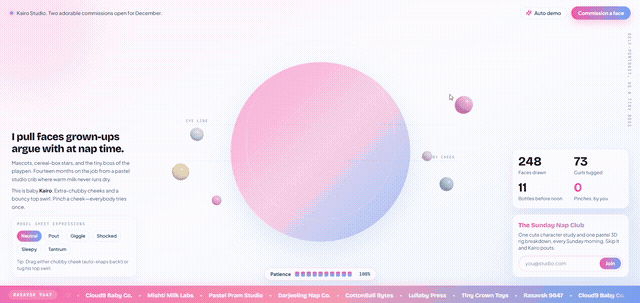
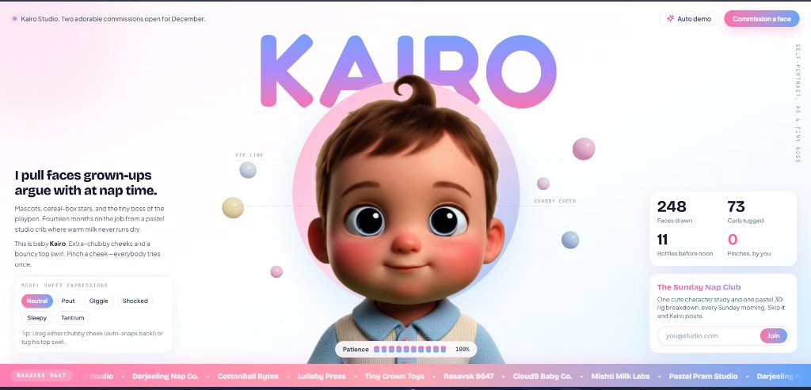
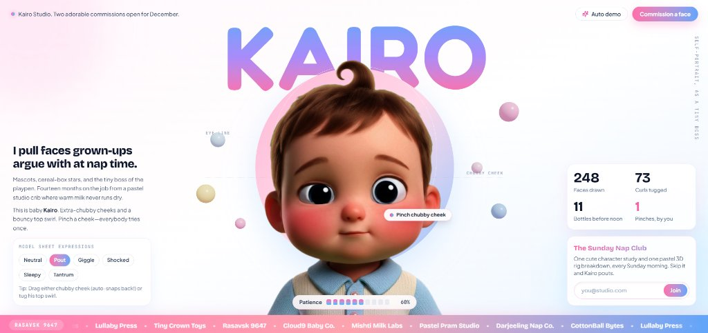
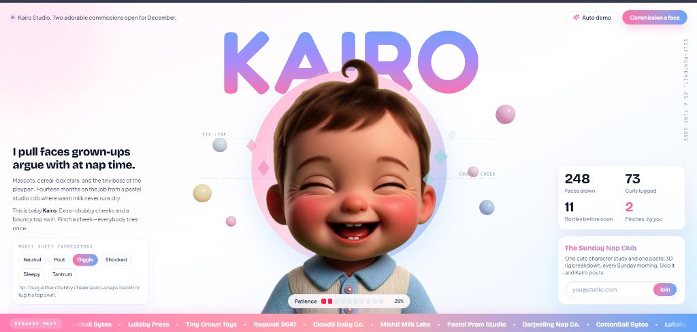
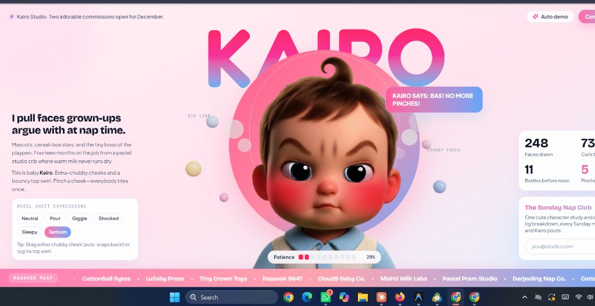
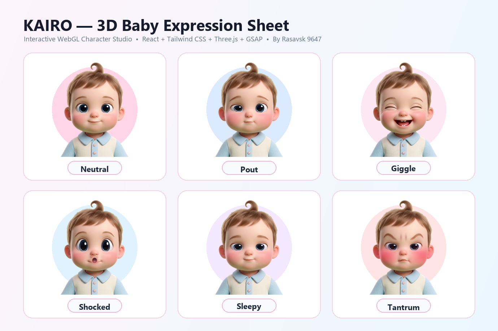

# Kairo Baby 3D

An interactive Pixar-soft 3D web character studio built with **Vite + React + Tailwind CSS v4 + Three.js + GSAP**, created by **Rasavsk 9647**.

> **Suggested GitHub Repository Name:** `kairo-baby-3d`

---

## Live Demo Video & Preview



Watch the full high-resolution interactive demo: [kairo-baby-demo.mp4](./docs/kairo-baby-demo.mp4)

---

## Live Reaction Screenshots

| Neutral | Pout (Chubby Cheek Pinch) |
| :---: | :---: |
|  |  |

| Giggle (With 3D Sparkles) | Tantrum (Angry V-Brows & Steam) |
| :---: | :---: |
|  |  |

---

## 6-Expression Model Sheet



| Neutral | Pout | Giggle |
| :---: | :---: | :---: |
|  |  |  |

| Shocked | Sleepy | Tantrum |
| :---: | :---: | :---: |
|  |  |  |

---

## Features

- **Pixar-Soft 2.5D/3D WebGL Stage (`BabyStage3D.jsx`):** Custom GLSL vertex and fragment shaders with spherical head/cheek/nose relief and subtle breathing.
- **Human-Like Neck-Anchored Head Movement:** Sweater shoulders stay stationary while Kairo’s head turns, nods, and tilts smoothly toward the cursor across the entire viewport.
- **Sclera-Safe Symmetrical Eye Tracking & Natural Blinking:** Rigid iris tracking inside natural sclera bounds with zero skin tears or ghost rims, plus periodic blinking.
- **Interactive Chubby Cheek Pinch & Curl Tug (Auto-Snap):** Drag either chubby cheek or tug Kairo’s top hair swirl—once pulled past threshold (or released), GSAP `elastic.out` springs it back automatically and updates his reaction and `Patience` meter.
- **6 Live Expressions:** `Neutral`, `Pout`, `Giggle` (floating 3D sparkles), `Shocked`, `Sleepy` (floating `Zzz`), and `Tantrum` (steep angry V-brows, ear steam puffs, and gentle rattle).
- **Cute Preloader & GSAP Choreography:** Pastel baby preloader synced with Three.js `LoadingManager`, staggered GSAP text/panel reveals, animated `KAIRO` display typography, and `Auto demo` mode.
- **Pastel White, Pink & Sky-Blue Studio UI:** Frosted cards, `Commission a face` modal, `"The Sunday Nap Club"` signup, and bottom `Rasavsk 9647` marquee strip.

---

## Tech Stack

- **Framework:** React 19 + Vite 6
- **Styling:** Tailwind CSS v4
- **3D & Shaders:** Three.js (`ShaderMaterial`, custom GLSL vertex/fragment rigging, `LoadingManager`)
- **Animations:** GSAP (`elastic.out`, `back.out`, staggered text & panel choreography)
- **Icons:** Lucide React

---

## Project Structure

```text
├── docs/
│   ├── kairo-baby-demo.mp4          # Full HD demo walkthrough
│   ├── kairo-baby-preview.gif       # Animated README loop preview
│   ├── kairo-expressions.png        # 6-expression model sheet
│   └── screenshots/                 # Live app reaction captures
├── public/assets/baby/              # Transparent Pixar-soft expression renders
├── src/
│   ├── components/
│   │   ├── BabyStage3D.jsx          # Three.js + GLSL head/eye/cheek rig
│   │   ├── CuteLoader.jsx           # Pastel loading screen synced with Three.js
│   │   ├── HeroBackdrop.jsx         # Animated KAIRO display letters & spotlight
│   │   ├── TopBar.jsx               # Header bar, Model sheet pill & Auto demo
│   │   ├── BioMoodPanel.jsx         # Studio bio & expression switcher
│   │   ├── StatsAddaPanel.jsx       # Interactive stats & Sunday Nap Club form
│   │   ├── PatienceMeter.jsx        # 100% -> 0% segmented patience meter
│   │   ├── ClientMarquee.jsx        # Rasavsk 9647 pastel footer marquee
│   │   └── CommissionModal.jsx      # Studio commission request modal
│   ├── data/bapiDaConfig.js         # Mood presets, lines & marquee entries
│   ├── App.jsx                      # State, GSAP entrance & interaction controller
│   └── index.css                    # Tailwind v4 + font helpers
└── package.json
```

---

## Getting Started

```bash
npm install
npm run dev
```

Build for production:

```bash
npm run build
```

---

Crafted by **Rasavsk 9647**
