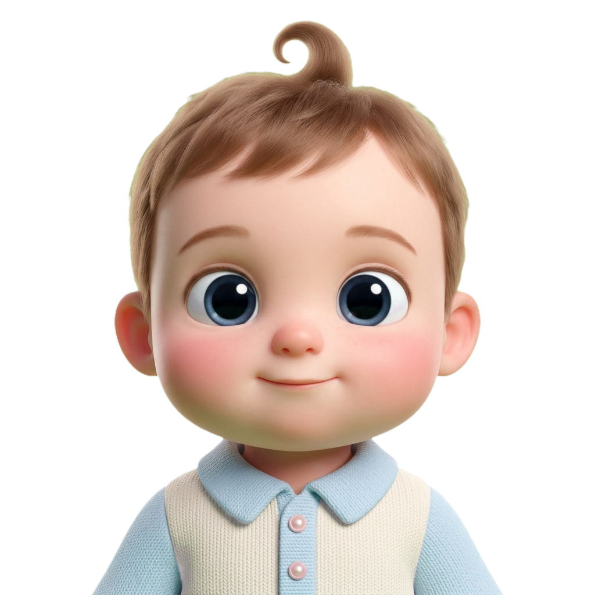
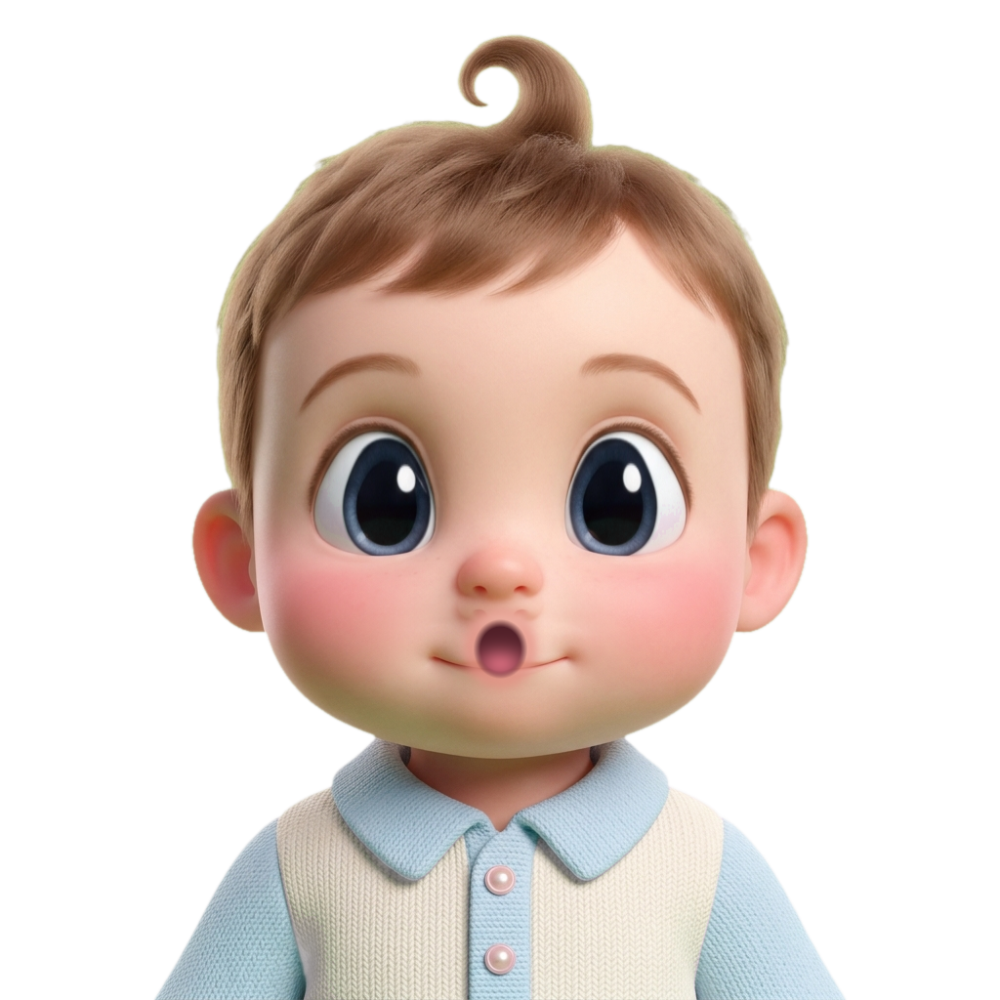

# KAIRO — Interactive 3D Baby Character Studio

An interactive Pixar-soft 3D web character experience built with **Vite + React + Tailwind CSS v4 + Three.js + GSAP**, created by **Rasavsk 9647**.


## Features

- **Pixar-Soft 2.5D/3D WebGL Stage (`BabyStage3D.jsx`)**: Custom GLSL vertex & fragment shaders over high-resolution transparent character renders, featuring soft spherical head/cheek/nose relief and subtle breathing.
- **Human-Like Neck-Anchored Head Movement**: Sweater shoulders stay stationary while Kairo’s head turns, nods, and tilts naturally toward your cursor across the entire viewport.
- **Sclera-Safe Symmetrical Eye Tracking & Natural Blinking**: Rigid iris tracking inside the natural sclera bounds with zero pink skin tears or ghost rims, plus automatic periodic blinks.
- **Interactive Chubby Cheek Pinch & Curl Tug (Auto-Snap)**: Drag either chubby cheek or tug Kairo’s top hair swirl—once pulled past threshold (or released), GSAP `elastic.out` springs it back automatically and updates his mood & `Patience` meter.
- **6 Live Expressions**:
  - `Neutral` • `Pout` • `Giggle` (with floating 3D sparkles) • `Shocked` • `Sleepy` (with floating `Zzz`) • `Tantrum` (with steep angry V-brows, ear steam puffs & gentle rattle).
- **Cute Preloader & GSAP Choreography**: Pastel cloud-baby preloader synced with Three.js `LoadingManager`, followed by staggered GSAP text/panel reveals and Kairo popping cleanly up from the bottom.
- **Pastel White, Pink & Sky-Blue Studio UI**: Frosted cards, animated `KAIRO` display typography (`Fredoka` + `Bricolage Grotesque`), `Auto demo` toggle, `Commission a face` modal, `"The Sunday Nap Club"` signup, and bottom `Rasavsk 9647` marquee strip.

## Expression Breakdown

| Neutral | Pout | Giggle |
| :---: | :---: | :---: |
|  |  |  |

| Shocked | Sleepy | Tantrum |
| :---: | :---: | :---: |
|  |  |  |

## Tech Stack

- **Framework:** React 19 + Vite 6
- **Styling:** Tailwind CSS v4
- **3D & Shaders:** Three.js (`ShaderMaterial`, custom GLSL vertex/fragment rigging, `LoadingManager`)
- **Animations:** GSAP (`elastic.out`, `back.out`, staggered text & panel choreography)
- **Icons:** Lucide React

## Project Structure

```text
├── public/assets/baby/          # Transparent Pixar-soft expression renders
├── docs/kairo-expressions.png   # 6-expression studio showcase sheet
├── src/
│   ├── components/
│   │   ├── BabyStage3D.jsx      # Three.js + GLSL head/eye/cheek rig
│   │   ├── CuteLoader.jsx       # Pastel loading screen synced with Three.js
│   │   ├── HeroBackdrop.jsx     # Animated KAIRO display letters & spotlight
│   │   ├── TopBar.jsx           # Header bar, Model sheet pill & Auto demo
│   │   ├── BioMoodPanel.jsx     # Studio bio & expression switcher
│   │   ├── StatsAddaPanel.jsx   # Interactive stats & Sunday Nap Club form
│   │   ├── PatienceMeter.jsx    # 100% -> 0% segmented patience meter
│   │   ├── ClientMarquee.jsx    # Rasavsk 9647 pastel footer marquee
│   │   └── CommissionModal.jsx  # Studio commission request modal
│   ├── data/bapiDaConfig.js     # Mood presets, lines & marquee entries
│   ├── App.jsx                  # State, GSAP entrance & interaction controller
│   └── index.css                # Tailwind v4 + font helpers
└── package.json
```

## Getting Started

```bash
npm install
npm run dev
```

Build for production:

```bash
npm run build
```

---

Crafted by **Rasavsk 9647**
